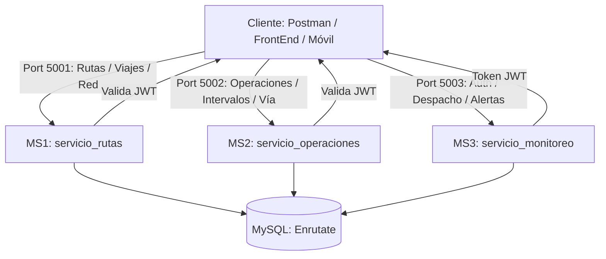

# 🏛️ Documentación Técnica Integral: Arquitectura de Microservicios EnRutate
**Sistema de Transporte Público Urbano - Popayán, Cauca**  
*Autor: Arquitecto Principal de Software (30 años de experiencia en Sistemas Distribuidos)*  
*Fecha: 2026*

---

## 📑 Tabla de Contenidos
1. [Visión General y Filosofía de Arquitectura](#1-visión-general-y-filosofía-de-arquitectura)
2. [Ecosistema de Microservicios y Puertos](#2-ecosistema-de-microservicios-y-puertos)
3. [Explicación Exhaustiva Archivo por Archivo](#3-explicación-exhaustiva-archivo-por-archivo)
   - [Microservicio 1: Gestión de Rutas y Red Vial (`servicio_rutas` - Puerto 5001)](#microservicio-1-gestión-de-rutas-y-red-vial-puerto-5001)
   - [Microservicio 2: Operaciones en Vía e Incidentes (`servicio_operaciones` - Puerto 5002)](#microservicio-2-operaciones-en-vía-e-incidentes-puerto-5002)
   - [Microservicio 3: Seguridad, Despacho No Lineal y Alertas (`servicio_monitoreo` - Puerto 5003)](#microservicio-3-seguridad-despacho-no-lineal-y-alertas-puerto-5003)
4. [La Lógica Aplicada: Modelos Matemáticos y Algoritmos No Lineales](#4-la-lógica-aplicada-modelos-matemáticos-y-algoritmos-no-lineales)
5. [Catálogo Completo de Endpoints y Payloads JSON (POST, PUT, DELETE, GET)](#5-catálogo-completo-de-endpoints-y-payloads-json)
   - [0. Autenticación y Obtención de Token](#0-autenticación-y-obtención-de-token-puerto-5003)
   - [1. Endpoints Microservicio 1: Rutas (Puerto 5001)](#1-endpoints-microservicio-1-rutas-puerto-5001)
   - [2. Endpoints Microservicio 2: Operaciones e Incidentes (Puerto 5002)](#2-endpoints-microservicio-2-operaciones-e-incidentes-puerto-5002)
   - [3. Endpoints Microservicio 3: Despacho y Alertas (Puerto 5003)](#3-endpoints-microservicio-3-despacho-y-alertas-puerto-5003)
6. [Guía de Arranque y Pruebas Rápidas](#6-guía-de-arranque-y-pruebas-rápidas)

---

## 1. Visión General y Filosofía de Arquitectura

En la ingeniería de software moderna, un sistema distribuido debe diseñarse bajo tres premisas no negociables:
1. **Límites de Contexto Claros (*Bounded Contexts*):** Cada servicio es dueño de su lógica de negocio y no se mezcla con las preocupaciones de otros dominios.
2. **Alta Cohesión y Bajo Acoplamiento:** Cada módulo realiza una sola tarea bien definida (*Single Responsibility Principle*).
3. **Resiliencia Operativa y Tolerancia a Fallos:** Manejo defensivo de conexiones a base de datos, tipos de datos horariostemporales variables y control estricto de seguridad perimetral.

El ecosistema **EnRutate** resuelve la problemática de movilidad de la ciudad de Popayán (calles coloniales angostas, alta demanda de estudiantes de la Universidad del Cauca, contingencias viales y rutas veredales con recargo tarifario).



---

## 2. Ecosistema de Microservicios y Puertos

| Microservicio | Directorio | Puerto | Protocolo | Responsabilidad Principal |
| :--- | :--- | :---: | :---: | :--- |
| **MS1: Gestión de Rutas** | `backend/servicio_rutas` | **`5001`** | REST / JSON | CRUD de rutas, algoritmos de viaje directo, transbordo multimodal, índice de congestión y comparativas. |
| **MS2: Operaciones en Vía** | `backend/servicio_operaciones` | **`5002`** | REST / JSON | Control de intervalos entre colectivos, cálculo de deltas horarios, paraderos secuenciales y reporte de incidentes viales. |
| **MS3: Monitoreo y Despacho** | `backend/servicio_monitoreo` | **`5003`** | REST / JSON | Autenticación centralizada (JWT + Rate Limit), despacho no lineal, tablas horarias, factor Unicauca y CRUD de alertas de emergencia. |

---

## 3. Explicación Exhaustiva Archivo por Archivo

A continuación se detalla la razón técnica de diseño, las decisiones de código y la responsabilidad de cada archivo dentro del proyecto.

---

### Microservicio 1: Gestión de Rutas y Red Vial (Puerto 5001)

#### 1. `config.py`
* **Capa:** Configuración e Infraestructura.
* **¿Por qué se hizo así?:**
  - Aplica el principio III de *The Twelve-Factor App* (almacenar la configuración en el entorno).
  - Utiliza `os.getenv` con valores de retroceso (*fallbacks*) como `localhost`, puerto `5001` y base de datos `Enrutate`.
  - Evita quemar credenciales en el código fuente (*Hardcoded Secrets*). Al cambiar de entorno (local a producción o contenedor Docker), sólo se configuran variables de entorno sin modificar el código.

#### 2. `database.py`
* **Capa:** Acceso a Base de Datos / Conexión.
* **¿Por qué se hizo así?:**
  - Implementa el patrón **Context Manager** mediante `@contextmanager` con la función `get_cursor(commit=False)`.
  - Configura `pymysql.cursors.DictCursor`, devolviendo los registros como diccionarios (`fila["fare"]`) en lugar de tuplas numéricas (`fila[5]`), lo que previene errores catastróficos si se reordenan las columnas en la base de datos.
  - **Garantía de Cierre de Conexiones:** El bloque `try ... finally: conn.close()` asegura que el socket TCP hacia MySQL se libere siempre, previniendo *Connection Leaks* bajo concurrencia.
  - **Control Transaccional ACID:** Si `commit=True` falla por una excepción en tiempo de ejecución, ejecuta de inmediato un `conn.rollback()`.

#### 3. `auth.py`
* **Capa:** Seguridad Perimetral / Middleware.
* **Política vigente:** Los endpoints protegidos requieren JWT; el registro público siempre asigna `USUARIO`, y las claves API no autentican ni conceden roles. La descripción de autenticación híbrida que sigue corresponde a una versión anterior.
* **¿Por qué se hizo así?:**
  - Implementa el decorador `@token_required` usando programación funcional con `functools.wraps`.
  - **Estrategia Híbrida de Autenticación:** Acepta tokens **JWT (Bearer Token)** validados con el secreto simétrico `popayan_secreto_transporte_jwt_2026` (algoritmo `HS256`) y alternativamente la cabecera rápida de desarrollo `X-API-KEY: 123`.
  - Desacoplamiento: No realiza llamadas HTTP remotas para validar el token; la validación criptográfica local reduce la latencia de respuesta a menos de 1 milisegundo.

#### 4. `models.py`
* **Capa:** Contrato de Datos / Dominio.
* **¿Por qué se hizo así?:**
  - Utiliza `@dataclass(slots=True)` para las estructuras `Route`, `TripPlanResult`, `TransferTripResult`, `RouteCongestionResult`, `TrafficSimulationResult` y `RouteComparisonResult`.
  - La directiva `slots=True` en Python evita la sobrecarga de crear un diccionario interno `__dict__` por cada instancia, reduciendo el consumo de memoria RAM y acelerando el acceso a propiedades en un 20-30%.
  - Funciona como contrato formal y legible del dominio del problema.

#### 5. `repository.py`
* **Capa:** DAO (Data Access Object) / Persistencia.
* **¿Por qué se hizo así?:**
  - Es el **único** lugar donde se escribe código SQL para la gestión de rutas.
  - **Seguridad contra SQL Injection (CWE-89):** Todas las consultas parametrizan los valores usando tuplas `(%s, ...)`.
  - Implementa la normalización defensiva `_row_to_route(row)` que valida tipos numéricos (`float`, `int`) y provee cadenas vacías seguras en caso de nulos (`None`), evitando que un dato corrupto en base de datos arroje un `TypeError` en el servidor.
  - Contiene las consultas de búsqueda espacial relacional:
    - `find_direct_trip`: JOIN entre `routes` y dos instancias de `stops` (`s1` y `s2`) condicionadas a `s1.stop_order < s2.stop_order`.
    - `find_transfer_trip`: Doble JOIN cruzado entre rutas y paraderos para ubicar el nodo común de intercambio de pasajeros.

#### 6. `routes/rutas.py`
* **Capa:** Controlador REST / API Routing.
* **¿Por qué se hizo así?:**
  - Modulado mediante Flask `Blueprint` con prefijo `/rutas`.
  - Desacopla la lógica de transporte de la persistencia: valida que los datos de entrada existan y tengan el tipo adecuado antes de invocar al repositorio.
  - Maneja códigos HTTP semánticos: `200 OK` para consultas y actualizaciones, `201 Created` para registros, `400 Bad Request` ante campos faltantes, `404 Not Found` para registros inexistentes y `500 Internal Server Error` ante fallos de base de datos.

#### 7. `routes/logicas.py`
* **Capa:** Lógica de Negocio Avanzada / Algoritmia.
* **¿Por qué se hizo así?:**
  - Agrupa los 5 algoritmos del servicio en un Blueprint independiente (`/logicas`).
  - Transforma datos crudos de paraderos e incidentes en diagnósticos ejecutivos útiles para los ciudadanos de Popayán (minutos estimados, confiabilidad porcentual y consejos preventivos).

#### 8. `app.py` y `server.py`
* **Capa:** Entrada y Ensamblado de la Aplicación.
* **¿Por qué se hizo así?:**
  - `app.py` aplica el **Application Factory Pattern** (`create_app()`), habilitando CORS y definiendo manejadores de error 404/500 uniformes en formato JSON.
  - `server.py` reconfigura la consola a `utf-8` para compatibilidad en terminales Windows PowerShell y despliega el banner informativo con todos los endpoints disponibles.

---

### Microservicio 2: Operaciones en Vía e Incidentes (Puerto 5002)

#### 1. `config.py` y `database.py`
* Mantiene la misma arquitectura desacoplada y el context manager de transacciones ACID bajo el puerto `5002`.

#### 2. `auth.py`
* Validador JWT y permisos por rol para asegurar que únicamente operadores autorizados puedan reportar incidentes o consultar intervalos de salida.

#### 3. `models.py`
* Modela las entidades de vía: `Dispatch` (despacho con placa y estampa temporal), `Stop` (paradero con referencia física y orden) e `Incident` (evento vial tipificado).

#### 4. `repository.py`
* Centraliza las consultas operativas:
  - `find_dispatch(route_id, bus_plate)`: Localiza el último registro de salida de un bus.
  - `find_stops_by_route(route_id)`: Retorna la secuencia física de paraderos ordenada por `stop_order ASC`.
  - `insert_incident(...)`: Inserción parametrizada de novedades viales.
  - `find_incidents_by_route(route_id)`: Consulta de novedades activas en la ruta.

#### 5. `routes/operaciones.py`
* **¿Por qué se hizo así y qué problemas resuelve?:**
  - **Función `_parse_time(time_val)`:** Resuelve una incompatibilidad común en entornos de producción: MySQL puede entregar el campo horario como `datetime`, como `timedelta` o como cadenas con distintos formatos (`%H:%M:%S`, `%H:%M`, etc.). Esta función parsea de forma segura cualquiera de estas variantes a un objeto `datetime` sin romper la ejecución.
  - **Diferencia entre Buses (`/diferencia-buses`):** Calcula los minutos exactos entre los despachos de dos buses en vía para monitorear el fenómeno de "persecución de buses" (*bus bunching*).
  - **Calculadora Horaria Directa (`/diferencia-horas`):** Permite calcular brechas de tiempo directas en minutos.
  - **Reporte y Consulta de Incidentes (`/incidente`, `/incidentes/<id>`):** Registro inmediato de bloqueos, congestión o accidentes.

#### 6. `app.py` y `server.py`
* Ensamblador de la aplicación Flask en el puerto `5002` con sus respectivos Blueprints.

---

### Microservicio 3: Seguridad, Despacho No Lineal y Alertas (Puerto 5003)

#### 1. `config.py`
* Configura variables de entorno, el secreto JWT aleatorio compartido entre los servicios y el puerto `5003`. El servicio falla al iniciar si falta un secreto válido.

#### 2. `auth.py`
* **Capa:** Criptografía y Seguridad Centralizada.
* **¿Por qué se hizo así?:**
  - `generate_token(user_data)`: Emite tokens JWT con algoritmo `HS256`, incluyendo identificador de usuario, rol y expiración de 24 horas.
  - `check_password(plain, hashed)`: **Validador de contraseñas polimórfico.** Soporta tanto hashes `scrypt` (estándar de alta seguridad de Werkzeug) como hashes directos `SHA-256`, garantizando compatibilidad retroactiva con cualquier usuario registrado en la base de datos.
  - `token_required`: Decorador que inyecta en la función el parámetro `current_user`.

#### 3. `database.py` y `repository.py`
* Capa de persistencia con soporte para consultas de usuarios (`users` y `usuarios`), telemetría de aforo, calificaciones de servicio y el ciclo de vida completo de las alertas de emergencia (`emergency_alerts`).

#### 4. `service.py` (`DespachoService`)
* **El Núcleo Algorítmico del Proyecto:** Contiene las 5 lógicas no lineales de programación y despacho operativo, adaptadas a las condiciones de Popayán (detalladas en la siguiente sección).

#### 5. `routes/login.py`
* **¿Por qué se hizo así?:**
  - Expone `POST /login`, `POST /register` y `GET /me`.
  - **Mitigación de Ataques de Fuerza Bruta:** Protegido con `flask-limiter` a un máximo de **5 intentos de login por minuto por IP** y **3 registros por minuto**. Si un atacante supera el umbral, el servidor responde automáticamente con HTTP `429 Too Many Requests`.

#### 6. `routes/despacho.py`
* Expone los endpoints de programación operativa: `/despacho/horario`, `/despacho/frecuencias`, `/despacho/tipo-vehiculo`, `/despacho/descanso-terminal` y `/despacho/rotacion-conductor`.

#### 7. `routes/alertas.py`
* **CRUD Completo de Alertas de Emergencia:**
  - `POST /monitoreo/alertas`: Registro de eventos críticos en vía (botón de pánico, colisiones, fallas mecánicas).
  - `GET /monitoreo/alertas`: Listado con cálculo de criticidad y tiempo máximo de respuesta.
  - `GET /monitoreo/alertas/<id>`: Detalle de una alerta específica.
  - `PUT /monitoreo/alertas/<id>`: Actualización de estado (ej. de `ACTIVA` a `RESUELTA`) y descripción.
  - `DELETE /monitoreo/alertas/<id>`: Eliminación física de registros.

#### 8. `app.py` y `server.py`
* Inicialización de la aplicación Flask, configuración del Rate Limiter en memoria local (`memory://`), configuración CORS y despliegue en el puerto `5003`.

---

## 4. La Lógica Aplicada: Modelos Matemáticos y Algoritmos No Lineales

Los microservicios incorporan modelos matemáticos diseñados para reflejar la realidad del transporte público:

### 1. Planificación de Viaje Directo y Secuencia de Paradas
* **Problema:** En transporte público, dos paraderos pueden pertenecer a la misma ruta pero en sentido contrario.
* **Lógica:** Se valida la condición estricta $Order_{origen} < Order_{destino}$. El tiempo estimado se calcula de forma no lineal con base en la densidad de paradas intermedias:
$$\text{Minutos Estimados} = \max(10, \text{Paradas Intermedias} \times 4)$$

### 2. Planificación Multimodal con Transbordo
* **Problema:** Un origen y un destino no cuentan con conexión directa.
* **Lógica:** Se ejecuta una intersección de grafos relacionales buscando un paradero común de trasbordo $T$ tal que:
$$R_1: \text{Origen} \to T \quad \land \quad R_2: T \to \text{Destino}$$
Se adicionan 12 minutos fijos de penalización por tiempo de espera en el nodo de conexión y se liquida la sumatoria de ambas tarifas.

### 3. Modelo de Decaimiento de Confiabilidad por Congestión
* **Lógica:** Evalúa los incidentes activos de la ruta. Cada tipo de novedad aplica una penalización sobre la confiabilidad del servicio y añade minutos de demora:
  - *Accidente vial:* $+20\text{ min}$, penalización $-30\%$.
  - *Desvío o cierre:* $+15\text{ min}$, penalización $-20\%$.
  - *Congestión vehicular:* $+10\text{ min}$, penalización $-15\%$.
$$\text{Confiabilidad (\%)} = \max(10.0, 100.0 - \sum \text{Penalizaciones})$$

### 4. Simulador de Horas Pico en Popayán
* **Lógica:** En Popayán el tráfico se concentra en tres franjas críticas:
  - Mañana: `06:30 - 08:30` (Entrada colegios, universidades y oficinas).
  - Mediodía: `11:45 - 13:45` (Jornada continua y almuerzo).
  - Tarde: `17:30 - 19:30` (Salida laboral y cierre de comercio).
* Si la hora consultada coincide con estas franjas, se aplica un factor de fricción de red de **$1.45\times$** (+45% de tiempo de recorrido):
$$\text{Tiempo Real} = \text{Tiempo Base} \times 1.45$$

### 5. Generación Dinámica de Tablas Horarias por Tipo de Día
* **Lógica:** La frecuencia de despacho no es plana; varía según el día de la semana y la hora:
  - **Día Hábil:** Frecuencia cada 8 minutos en horas pico; cada 15 a 20 minutos en horas valle.
  - **Sábado:** Alta demanda comercial entre 9:00 y 14:00 (frecuencia cada 10 min).
  - **Domingo:** Operación relajada con salidas cada 15 a 30 minutos.
  - **Festivo:** Inicio tardío de despachos a las 08:00 con intervalos de 20 a 35 minutos.

### 6. Modelo de Frecuencias con "Factor Unicauca" y Corredores
* **Lógica:** La Universidad del Cauca moviliza a más de 18.000 estudiantes entre sus campus (Tulcán, Santo Domingo, Facultad de Salud, Los Naranjos).
  - Si la ruta atraviesa estos sectores en día hábil y horario de clases, se aplica un multiplicador de **$+20\%$** en la demanda estudiantil.
  - Se clasifica el corredor:
    - *Troncal / Galerías / Variante:* factor $1.20\times$.
    - *Rural / Veredal (Cajete, Pisojé, Santa Teresa):* factor $0.55\times$ (menor densidad).
    - *Urbana barrial:* factor $0.90\times$.
* La flota mínima por hora se dimensiona para garantizar una ocupación objetivo del 75%:
$$\text{Buses Requeridos} = \left\lceil \frac{\text{Demanda Real}}{\text{Capacidad Bus} \times 0.75} \right\rceil$$

### 7. Asignación de Colectivo y Balance de Recaudo
* **Lógica:** En Popayán la flota homologada corresponde a colectivos de 19, 25 o 32 asientos.
  - Cada asiento representa un pasajero sentado y cada pasajero abona la tarifa oficial ($3.000 COP urbana; $3.200 vereda cercana; $3.400 vereda lejana).
  - El costo operativo por combustible y desgaste mecánico incluye una penalización exponencial por distancia:
$$\text{Factor Distancia} = 1.0 + \left( \frac{\text{Longitud (km)}}{50} \right)^2$$
$$\text{Balance Neto} = \text{Recaudo Total} - (\text{Costo/km} \times \text{Km} \times \text{Factor Distancia})$$

### 8. Control de Descanso en Terminal por Fatiga Cuadrática
* **Lógica:** Basado en la Resolución 315 de 2013 de Colombia (descanso de 15 min por cada 2h continuas).
* Si las horas de conducción superan las 4 horas, el factor de fatiga crece de forma cuadrática:
$$\text{Factor Fatiga} = 1.3 + 0.4 \times (\text{Horas} - 4.0)^{1.5}$$
* Si el conductor acumula más de 8 horas en la jornada, el sistema emite una alerta crítica de relevo obligatorio.

### 9. Optimizador de Rotación de Conductor
* **Lógica:** Calcula un score continuo de fatiga (0 a 100%) combinando horas al volante, incidentes viales y kilómetros acumulados:
$$\text{Score Fatiga} = (\text{Horas} \times 9.5) + (\text{Km} \times 0.08) + (\text{Incidentes} \times 12.0)$$
* Si el score supera el 75%, el sistema ordena rotación preventiva en cabecera.

---

## 5. Catálogo Completo de Endpoints y Payloads JSON

> **Cabeceras obligatorias para todos los endpoints protegidos (excepto `/login` y `/register`):**
> ```http
> Authorization: Bearer <TOKEN_JWT>
> ```
> Las claves API no son válidas para autenticar solicitudes a este servicio.
> ```http
> Content-Type: application/json
> ```

---

### 0. Autenticación y Obtención de Token (Puerto 5003)

#### `POST /login` (Público - Rate Limit: 5 peticiones/minuto)
* **URL:** `http://127.0.0.1:5003/login`
* **JSON Request:**
```json
{
  "username": "admin",
  "password": "admin123"
}
```
* **JSON Response (200 OK):**
```json
{
  "expira_horas": 24,
  "role": "ADMIN",
  "success": true,
  "tipo": "Bearer",
  "token": "eyJhbGciOiJIUzI1NiIsInR5cCI6IkpXVCJ9.eyJ1c2VyX2lkIjoxLCJ1c2VybmFtZSI6ImFkbWluIiwicm9sZSI6IkFETUlOIiwiZXhwIjoxNzk0OTk4MDAwfQ.XYZ...",
  "username": "admin"
}
```

#### `POST /register` (Público, siempre crea rol `USUARIO` - Rate Limit: 3 peticiones/minuto)
* **URL:** `http://127.0.0.1:5003/register`
* **JSON Request:**
```json
{
  "username": "despachador_norte",
  "password": "claveSegura2026"
}
```
* **JSON Response (201 Created):**
```json
{
  "mensaje": "Cuenta de usuario 'despachador_norte' creada correctamente.",
  "success": true
}
```

El cliente no puede seleccionar el rol al registrarse: el endpoint lo fija en `USUARIO` aunque se envíe un campo `role`. Para crear un administrador, un administrador de MySQL debe registrar primero la cuenta y luego ejecutar `UPDATE users SET role = 'ADMIN' WHERE username = 'nombre_de_usuario';`.

---

### 1. Endpoints Microservicio 1: Rutas (Puerto 5001)

#### `POST /rutas` (Crear nueva ruta)
* **URL:** `http://127.0.0.1:5001/rutas`
* **JSON Request:**
```json
{
  "code": "SC3M",
  "company": "Sotracauca",
  "origin": "Loma de la Virgen",
  "destination": "Centro Comercial Terraplaza",
  "fare": 3000.0,
  "schedule": "05:30 - 21:00"
}
```
* **JSON Response (201 Created):**
```json
{
  "mensaje": "Ruta 'SC3M' registrada correctamente",
  "success": true
}
```

#### `PUT /rutas/<id>` (Actualizar ruta existente)
* **URL:** `http://127.0.0.1:5001/rutas/1`
* **JSON Request:**
```json
{
  "code": "RUTA-1",
  "company": "Sotracauca Metropoli",
  "origin": "Barrio Bolívar",
  "destination": "Campanario / Variante Norte",
  "fare": 3000.0,
  "schedule": "05:00 - 22:00",
  "status": "ACTIVA"
}
```
* **JSON Response (200 OK):**
```json
{
  "data": {
    "code": "RUTA-1",
    "company": "Sotracauca Metropoli",
    "destination": "Campanario / Variante Norte",
    "fare": 3000.0,
    "id": 1,
    "origin": "Barrio Bolívar",
    "schedule": "05:00 - 22:00",
    "status": "ACTIVA"
  },
  "success": true
}
```

#### `DELETE /rutas/<id>` (Eliminar ruta)
* **URL:** `http://127.0.0.1:5001/rutas/6`
* **JSON Request:** *(Vacío / No requerido)*
* **JSON Response (200 OK):**
```json
{
  "mensaje": "Ruta 6 eliminada correctamente",
  "success": true
}
```

#### Endpoints GET de Consulta y Lógicas (MS1):
* `GET http://127.0.0.1:5001/rutas`: Listar todas las rutas activas.
* `GET http://127.0.0.1:5001/rutas/1`: Detalle de ruta por ID.
* `GET http://127.0.0.1:5001/rutas/buscar?zona=Campanario`: Búsqueda por sector.
* `GET http://127.0.0.1:5001/logicas/viaje-directo?origin=La Paz&destination=Los Naranjos`: Planificador directo.
* `GET http://127.0.0.1:5001/logicas/viaje-transbordo?origin=Lomas de Granada&destination=Variante Norte`: Viaje con transbordo.
* `GET http://127.0.0.1:5001/logicas/congestion/1`: Índice de congestión y confiabilidad.
* `GET http://127.0.0.1:5001/logicas/trafico/1?hora=07:30`: Simulación por hora pico.
* `GET http://127.0.0.1:5001/logicas/comparar?ruta1=1&ruta2=2`: Comparador de eficiencia.

---

### 2. Endpoints Microservicio 2: Operaciones e Incidentes (Puerto 5002)

#### `POST /operaciones/incidente` (Reportar incidente vial)
* **URL:** `http://127.0.0.1:5002/operaciones/incidente`
* **JSON Request:**
```json
{
  "route_id": 1,
  "incident_type": "CONGESTION",
  "description": "Alto flujo vehicular por obras de pavimentación en el sector del Puente del Humilladero.",
  "reported_by": "Despachador Central"
}
```
* **JSON Response (201 Created):**
```json
{
  "mensaje": "Incidente 'CONGESTION' registrado en ruta 1.",
  "success": true
}
```

#### Endpoints GET de Control Operativo (MS2):
* `GET http://127.0.0.1:5002/operaciones/diferencia-buses?route_id=1&bus1=TPK-102&bus2=TPK-102`: Diferencia entre dos colectivos.
* `GET http://127.0.0.1:5002/operaciones/diferencia-horas?hora1=06:30&hora2=07:15`: Delta horario directo en minutos.
* `GET http://127.0.0.1:5002/operaciones/paraderos/1`: Listar paraderos secuenciales de una ruta.
* `GET http://127.0.0.1:5002/operaciones/incidentes/1`: Consultar incidentes activos de la ruta.

---

### 3. Endpoints Microservicio 3: Despacho y Alertas (Puerto 5003)

#### `POST /despacho/horario` (Generar tabla horaria de salidas)
* **URL:** `http://127.0.0.1:5003/despacho/horario`
* **JSON Request:**
```json
{
  "route_id": 1,
  "tipo_dia": "HABIL",
  "hora_inicio": "05:00",
  "hora_fin": "21:00"
}
```
* **JSON Response (200 OK):**
```json
{
  "data": {
    "frecuencia_promedio_min": 12.8,
    "hora_fin": "21:00",
    "hora_inicio": "05:00",
    "nota": "Horario generado con 76 despachos. Frecuencia variable por franja horaria de Popayan.",
    "route_id": 1,
    "tabla_horaria": [
      {"frecuencia_min": 20, "franja": "Madrugada (Valle)", "hora_salida": "05:00"},
      {"frecuencia_min": 8,  "franja": "Pico Mañana",       "hora_salida": "07:00"}
    ],
    "tipo_dia": "HABIL",
    "total_salidas": 76
  },
  "success": true
}
```

#### `POST /despacho/frecuencias` (Frecuencias mínimas y factor Unicauca)
* **URL:** `http://127.0.0.1:5003/despacho/frecuencias`
* **JSON Request:**
```json
{
  "route_id": 1,
  "hora": 7,
  "tipo_dia": "HABIL",
  "capacidad_bus": 19
}
```
* **JSON Response (200 OK):**
```json
{
  "data": {
    "buses_requeridos": 39,
    "capacidad_bus": 19,
    "codigo_ruta": "RUTA-1",
    "empresa": "Sotracauca",
    "factor_unicauca": 1.2,
    "hora": "07:00",
    "impacto_universitario": "ACTIVO (+20%): La ruta pasa por campus de Unicauca en hora pico de entrada/salida a clases.",
    "intervalo_minutos": 2,
    "nivel_demanda": "DEMANDA_ALTA_HORA_PICO",
    "pasajeros_hora_estimados": 547,
    "recomendacion": "Para la ruta RUTA-1 (Sotracauca), despachar 1 colectivo cada 2 min (39 colectivos/hora). Demanda proyectada: 547 pasajeros/hora.",
    "route_id": 1,
    "tipo_corredor": "TRONCAL_ALTA_AFLUENCIA (Conecta centros comerciales, galerías y variantes)",
    "tipo_dia": "HABIL"
  },
  "success": true
}
```

#### `POST /despacho/tipo-vehiculo` (Asignación de colectivo y balance tarifario)
* **URL:** `http://127.0.0.1:5003/despacho/tipo-vehiculo`
* **JSON Request:**
```json
{
  "route_id": 1,
  "hora": 8,
  "pasajeros_estimados": 24,
  "longitud_ruta_km": 15.0,
  "es_vereda": false
}
```
* **JSON Response (200 OK):**
```json
{
  "data": {
    "alerta": "CAPACIDAD_LIMITE: Colectivo casi lleno (24/25 asientos ocupados, 1 libres).",
    "analisis_asientos_y_pasajes": {
      "asientos_libres": 1,
      "asientos_ocupados": 24,
      "asientos_totales": 25,
      "balance_neto_vuelta": "$47,430 COP",
      "costo_operativo_ruta": "$24,570 COP",
      "tarifa_por_pasajero": "$3,000 COP",
      "tipo_trayecto": "URBANO",
      "total_recaudo_pasajes": "$72,000 COP"
    },
    "hora": "08:00",
    "pasajeros_estimados": 24,
    "route_id": 1,
    "vehiculo_asignado": {
      "capacidad_asientos": 25,
      "descripcion": "Buseta colectiva estándar de Popayán (25 asientos)",
      "ocupacion_pct": "96.0%",
      "tamano": "MEDIANO (BUSETA)",
      "tipo": "COLECTIVO"
    }
  },
  "success": true
}
```

#### `POST /despacho/descanso-terminal` (Control de descanso por fatiga cuadrática)
* **URL:** `http://127.0.0.1:5003/despacho/descanso-terminal`
* **JSON Request:**
```json
{
  "route_id": 1,
  "bus_plate": "TPK-102",
  "horas_en_ruta": 4.5,
  "km_recorridos": 75.0,
  "hora_llegada": "13:30"
}
```
* **JSON Response (200 OK):**
```json
{
  "data": {
    "alerta": "Descanso de 33 min requerido antes de iniciar el regreso.",
    "bus_plate": "TPK-102",
    "cumple_reglamento": true,
    "descanso_requerido_min": 33,
    "factor_fatiga": 1.441,
    "hora_llegada": "13:30",
    "horas_en_ruta": 4.5,
    "km_recorridos": 75.0,
    "nivel_fatiga": "FATIGA_MODERADA",
    "proxima_salida": "14:03",
    "route_id": 1
  },
  "success": true
}
```

#### `POST /despacho/rotacion-conductor` (Optimizador de rotación)
* **URL:** `http://127.0.0.1:5003/despacho/rotacion-conductor`
* **JSON Request:**
```json
{
  "nombre_conductor": "Jairo Ordóñez",
  "empresa": "Sotracauca",
  "horas_acumuladas": 7.5,
  "km_acumulados": 185.0,
  "turnos_del_dia": 2,
  "incidentes_reportados": 1
}
```
* **JSON Response (200 OK):**
```json
{
  "data": {
    "conductor": "Jairo Ordóñez",
    "decision": "ROTACION_SUGERIDA",
    "empresa": "Sotracauca",
    "horas_acumuladas": 7.5,
    "km_acumulados": 185.0,
    "nivel_riesgo": "ALTO",
    "recomendacion": "El conductor acumula 7.5h al volante con un score de fatiga del 78.5%. Se sugiere relevo en cabecera.",
    "score_fatiga_pct": 78.5
  },
  "success": true
}
```

#### `POST /monitoreo/alertas` (Registrar alerta crítica de emergencia)
* **URL:** `http://127.0.0.1:5003/monitoreo/alertas`
* **JSON Request:**
```json
{
  "route_id": 1,
  "bus_plate": "TPK-102",
  "alert_type": "BOTON_PANICO",
  "severity_level": "ALTA",
  "criticality_score": 85.0,
  "max_response_time_minutes": 10,
  "location_landmark": "Barrio Bolívar",
  "description": "Alerta de pánico activada por el conductor en el paradero principal."
}
```
* **JSON Response (201 Created):**
```json
{
  "data": {
    "alert_type": "BOTON_PANICO",
    "bus_plate": "TPK-102",
    "criticality_score": 85.0,
    "description": "Alerta de pánico activada por el conductor en el paradero principal.",
    "id": 4,
    "location_landmark": "Barrio Bolívar",
    "max_response_time_minutes": 10,
    "route_id": 1,
    "severity_level": "ALTA",
    "status": "ACTIVA"
  },
  "mensaje": "Alerta crítica #4 generada exitosamente",
  "success": true
}
```

#### `PUT /monitoreo/alertas/<id>` (Actualizar alerta de monitoreo)
* **URL:** `http://127.0.0.1:5003/monitoreo/alertas/4`
* **JSON Request:**
```json
{
  "status": "RESUELTA",
  "description": "Novedad atendida por el cuadrante policial en el Barrio Bolívar. Colectivo reanuda su marcha.",
  "severity_level": "BAJA",
  "location_landmark": "Barrio Bolívar - CAI"
}
```
* **JSON Response (200 OK):**
```json
{
  "data": {
    "alert_type": "BOTON_PANICO",
    "bus_plate": "TPK-102",
    "criticality_score": 85.0,
    "description": "Novedad atendida por el cuadrante policial en el Barrio Bolívar. Colectivo reanuda su marcha.",
    "id": 4,
    "location_landmark": "Barrio Bolívar - CAI",
    "max_response_time_minutes": 10,
    "route_id": 1,
    "severity_level": "BAJA",
    "status": "RESUELTA"
  },
  "mensaje": "Alerta 4 actualizada correctamente",
  "success": true
}
```

#### `DELETE /monitoreo/alertas/<id>` (Eliminar alerta de monitoreo)
* **URL:** `http://127.0.0.1:5003/monitoreo/alertas/4`
* **JSON Request:** *(Vacío / No requerido)*
* **JSON Response (200 OK):**
```json
{
  "alerta_eliminada": {
    "alert_type": "BOTON_PANICO",
    "bus_plate": "TPK-102",
    "id": 4,
    "status": "RESUELTA"
  },
  "mensaje": "Alerta de monitoreo #4 eliminada exitosamente",
  "success": true
}
```

---

## 6. Guía de Arranque y Pruebas Rápidas

### 1. Activar Entorno Virtual e Instalar Dependencias
```powershell
.\venv\Scripts\Activate.ps1
pip install -r requirements.txt
```

### 2. Importar Base de Datos MySQL
Ejecutar el script [`base_de_datos/esquema_bd.sql`](file:///c:/Users/Usuario/Downloads/proyecto%20rutas/base_de_datos/esquema_bd.sql) en phpMyAdmin, DBeaver o consola MySQL.

### 3. Iniciar los 3 Microservicios en Terminales Separadas
```powershell
# Terminal 1: Microservicio 1 (Puerto 5001)
python .\backend\servicio_rutas\server.py

# Terminal 2: Microservicio 2 (Puerto 5002)
python .\backend\servicio_operaciones\server.py

# Terminal 3: Microservicio Central (Puerto 5003)
python .\backend\servicio_monitoreo\server.py
```

### 4. Importar Colección Postman Lista para Usar
El repositorio incluye el archivo [`postman_collection.json`](file:///c:/Users/Usuario/Downloads/proyecto%20rutas/postman_collection.json) con todas las peticiones previamente parametrizadas con variables de entorno, tokens y cuerpos de prueba listos para disparar con un solo clic.
